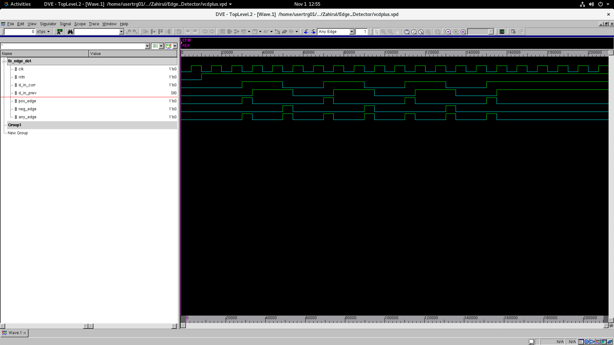

# Edge Detector

Edge detector that detects positive, negative, and any edges between clock cycles.

It does not detect multiple edges occurring within a single clock cycle.

## How it works

The previous input, `d_in_prev`, is stored at every positive edge of `clk`. The current input, `d_in_curr`, is compared with the previous input to detect the edges.

- `pos_edge`: 0 -> 1
- `neg_edge`: 1 -> 0
- `any_edge`: 0 -> 1 or 1 -> 0

```verilog
assign pos_edge = ~d_in_prev & d_in_curr;
assign neg_edge = d_in_prev & ~d_in_curr;
assign any_edge = d_in_prev ^ d_in_curr;
```

The outputs are combinational. When the current input changes, the corresponding output goes high until the next positive clock edge updates `d_in_prev`, provided the input stays at its new value.

The reset, `rstn`, is active low and asynchronous. When `rstn` is low, `d_in_prev` is cleared to `0`. The outputs are not gated by reset, so a high `d_in_curr` can still make `pos_edge` and `any_edge` high during reset.

## Input and Output signals

| Signal | Direction | Description |
| --- | --- | --- |
| `clk` | Input | Clock used to store the previous input. |
| `rstn` | Input | Active-low asynchronous reset. |
| `d_in_curr` | Input | Current input to be checked for edges. |
| `pos_edge` | Output | Detects a positive edge, 0 -> 1. |
| `neg_edge` | Output | Detects a negative edge, 1 -> 0. |
| `any_edge` | Output | Detects either edge, 0 -> 1 or 1 -> 0. |

## Edge Detection

| Previous input | Current input | `pos_edge` | `neg_edge` | `any_edge` |
| --- | --- | --- | --- | --- |
| 0 | 0 | 0 | 0 | 0 |
| 0 | 1 | 1 | 0 | 1 |
| 1 | 0 | 0 | 1 | 1 |
| 1 | 1 | 0 | 0 | 0 |

## Simulation



